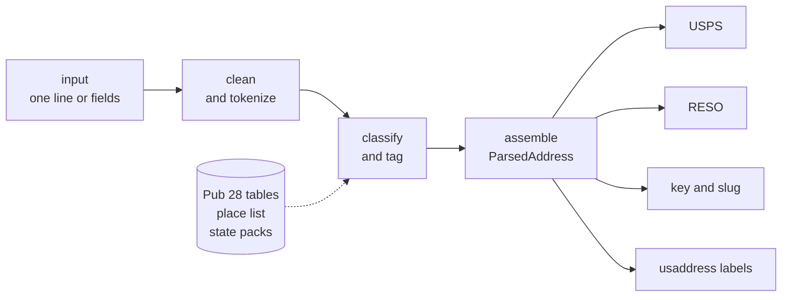
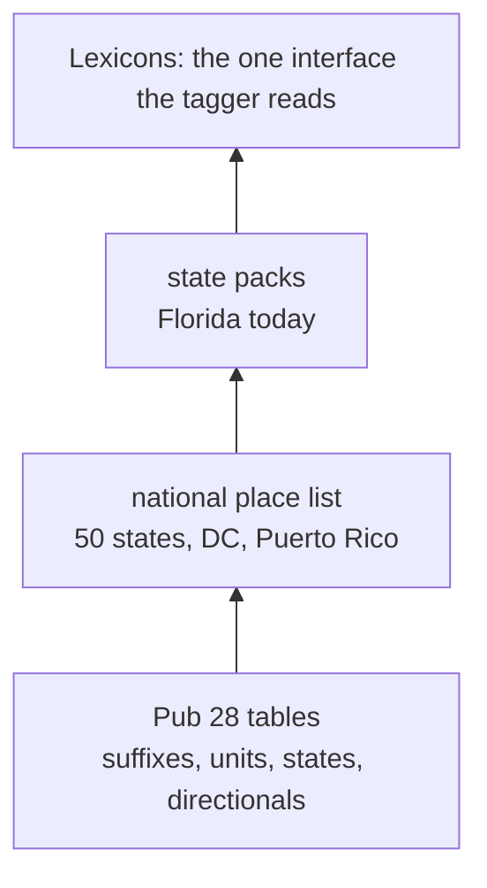

# doorplate

[](https://github.com/jeremeybingham/doorplate/actions/workflows/ci.yml)
[](https://github.com/jeremeybingham/doorplate/actions/workflows/wheels.yml)
[](#license)
[](crates/doorplate-py/README.md)
[](Cargo.toml)

Parse a US address into its parts, format it the way the Postal Service and the
real estate industry write it, and get a stable key to match it against other
records. `doorplate` is a Rust library with a Python package and a command-line
tool. It runs offline with no runtime dependencies and no data to download.

For one line or separate fields it gives you:

- **components**: street number, directionals, street name, suffix, units, city,
  state, ZIP, and the less common shapes (PO boxes, rural and highway routes,
  military and general delivery);
- **USPS Publication 28** and **RESO Data Dictionary 2.0** output;
- a **canonical match key** (`k1:...`) and a URL-safe **slug**;
- **diagnostics**: warnings with stable codes and the text it could not place, so
  you can send doubtful rows to review.

> **This is not an address validator.** `doorplate` parses and formats. It does
> not check that an address exists or can receive mail; Pub 28 formatting is not
> deliverability, and validation needs postal-service-certified data. Warnings
> such as `zip_city_mismatch` are hints about the input, not verdicts.

## Quickstart

```sh
pip install doorplate
```

```python
import doorplate

a = doorplate.parse("123 north main street apt 4, Miami FL 33101")

a.street_name, a.unit_number        # ("MAIN", "4")
a.to_usps()["line1"]                # "123 N MAIN ST APT 4"
a.key()                             # "k1:S|123|N|MAIN|ST||FL|33101"
a.slug()                            # "123-n-main-st-apt-4-miami-fl-33101"
a.warnings                          # []
```

The same from the command line, and the same address written another way gives
the same key:

```sh
$ doorplate parse "123 N. Main St #4, miami, fl 33101" --usps
123 N MAIN ST # 4
MIAMI FL 33101
$ doorplate parse "123 N. Main St #4, miami, fl 33101" | jq -r .key
k1:S|123|N|MAIN|ST||FL|33101
```

## What you get

One address, followed through:

| Input | `123 north main street apt 4, Miami FL 33101` |
|---|---|
| Components | street number `123`, predirectional `N`, name `MAIN`, suffix `ST`, unit `APT 4`, city `MIAMI`, state `FL`, ZIP `33101` |
| Place | `MIAMI`, Dade County, found by name (`city` keeps what you wrote) |
| USPS (Pub 28) | `123 N MAIN ST APT 4` / `MIAMI FL 33101` |
| RESO | `StreetNumber` `123`, `StreetDirPrefix` `N`, `StreetName` `MAIN`, `StreetSuffix` `ST`, `UnitNumber` `APT 4`, `City` `MIAMI`, `StateOrProvince` `FL`, `PostalCode` `33101`, `UnparsedAddress` `123 N MAIN ST APT 4, MIAMI, FL 33101` |
| Key | `k1:S|123|N|MAIN|ST||FL|33101` (with the unit: `k1:S|123|N|MAIN|ST||FL|33101|4|`) |
| Slug | `123-n-main-st-apt-4-miami-fl-33101` |
| Warnings | none |

**The key** identifies a property for deduplication and joins. It uses the street
parts, state and ZIP, not the city, and it is versioned: the `k1:` format will not
change in place. [`docs/key-format.md`](docs/key-format.md) is the contract.
**The slug** is for URLs and display; it is not unique. **Warnings** are stable
snake_case codes (`missing_zip`, `unparsed_remainder`, `dual_address`, ...) meant
for a database column; the list is in [`docs/how-it-works.md`](docs/how-it-works.md).

Input does not have to be tidy. Messy and incomplete addresses still parse, with
warnings that say what is missing:

```python
>>> a = doorplate.parse("12 elm st. #5 orlando fl")
>>> a.to_usps()["line1"], a.key(), a.warnings
('12 ELM ST # 5', 'k1n:S|12||ELM|ST||FL|', ['missing_zip'])
```

With no ZIP the key starts `k1n:` (a weaker match), and `missing_zip` says why.
Only input with no address text at all is an error.

## Install

**Python 3.10 or later** (one abi3 wheel per platform: Linux, macOS, Windows):

```sh
pip install doorplate                 # the parser
pip install "doorplate[pandas]"       # plus DataFrame helpers (or [polars])
```

**Rust:**

```sh
cargo add doorplate                   # the library
cargo install doorplate-cli           # the `doorplate` command (and its `addr` alias)
```

**From source** (Rust 1.80 or later; the Python extension needs 1.83):

```sh
git clone https://github.com/jeremeybingham/doorplate && cd doorplate
cargo build --release -p doorplate-cli          # target/release/doorplate
cd crates/doorplate-py && pip install maturin && maturin develop --release
```

## Using it

### Python

```python
import doorplate

doorplate.parse_fields(line1="THE COVE", line2="1111 ASBURY WAY",
                       city="Orlando", state="FL", zip="32801")   # pre-split fields
doorplate.parse_many(["1 Main St, Miami FL", "PO Box 5, Tampa FL"])  # parallel, GIL released
doorplate.parse("281 EVELYN DR DOTHAN", default_state="AL").city     # "DOTHAN"
doorplate.tag("PO Box 12, Tampa FL 33601")    # ({...usaddress labels...}, "PO Box")
```

`parse_many` parses a list on all cores and keeps the order. For a pandas or
Polars column, `doorplate.pandas.parse_column` and `doorplate.polars.parse_column`
return component columns in one call. Details, the DataFrame recipes and the
types: [`crates/doorplate-py/README.md`](crates/doorplate-py/README.md).

### Rust

```rust
use doorplate::{KeyOptions, Parser};

let parser = Parser::new();
let a = parser.parse("123 north main street apt 4, Miami FL 33101")?;
assert_eq!(a.street_name.as_deref(), Some("MAIN"));
assert_eq!(a.unit_number.as_deref(), Some("4"));

a.to_usps().line1;                // Some("123 N MAIN ST APT 4")
a.to_reso();                      // RESO Data Dictionary 2.0 fields
a.key(KeyOptions::property());    // Some("k1:S|123|N|MAIN|ST||FL|33101")
a.slug();                         // Some("123-n-main-st-apt-4-miami-fl-33101"), display only
a.diagnostics.warnings;           // e.g. MissingZip, UnparsedRemainder
```

`Parser::parse_fields` takes pre-split fields (`Fields`); `Parser::parse_many`
parses a batch, in parallel with the `rayon` feature.
`Parser::with_options(ParseOptions { default_state: Some("FL".into()) })?` sets a
state hint.

### Command line

```sh
doorplate parse "123 N Main St, Miami FL 33101" --pretty     # JSON: components, output, key, warnings
doorplate parse-file in.csv --column address -o out.csv      # appends addr_* columns
doorplate parse "281 EVELYN DR DOTHAN" --default-state AL
doorplate parse "123 N Main St, Miami FL 33101" --tag        # usaddress-style joined labels
doorplate parse -  < addresses.txt                           # one address per line, JSON lines out
```

`doorplate --help` lists every option. `addr` is a short alias for the same binary.

### A state hint

When the input names no state and has no known ZIP, `default_state` lets the parser
look the city up in that state: `281 EVELYN DR DOTHAN` finds `DOTHAN` with `AL`. It
is a hint, never a fill: `state` stays empty, `missing_state` still fires, and
`default_state_applied` says when the hint decided something.

## How it works



The parser is rules plus place data. There is no machine-learned model, so the same
input gives the same output on every platform, and a fix is a rule or a line of
data rather than a retraining. The last line of the address (ZIP, state, city) is
read first, right to left, then the delivery line from both ends. A place list
tells a city from street words on a line with no commas. The output formats read the
parsed address and never re-parse it. Parsing never panics: odd input comes back
with warnings. [`docs/how-it-works.md`](docs/how-it-works.md) has the details.

### Place data



A **national list** of 50,375 places and 41,154 ZIPs (Census Gazetteer and GeoNames
postal codes) lets the parser find the city on a line with no commas, tell
`WINGATE ST, 32507` (a street) from `PALM BEACH, 33480` (a city), and complete a cut-off
city. A **state pack** is hand-checked data for one state, added where real data
shows a need; Florida is the first. Layers only add to each other. `city` always keeps
what the input said; the place found is reported beside it. Sources and licenses:
[`docs/places.md`](docs/places.md) and [`docs/packs/fl.md`](docs/packs/fl.md).

## Accuracy and speed

| | doorplate | usaddress |
|---|---|---|
| Whole address right, geocode benchmark (30,622 one-line addresses) | 96.4% | 88.2% |
| One address from Python | 21 µs | 82 µs |
| 100,000 addresses (`parse_many` / a loop of `usaddress.parse`) | 0.32 s | 8.2 s |
| Installed size | 1.7 MB wheel | 4.8 MB with dependencies |

The rules and the place list were developed while reading this benchmark's errors,
so read 96.4% as an estimate for data of that shape, not a guarantee for yours.
Method, caveats, memory and Rust timings: [`docs/benchmarks.md`](docs/benchmarks.md).

## What it does not do

- It does not validate that an address exists or can receive mail.
- It does not geocode, match fuzzily, correct addresses, or handle international
  addresses. Recipient lines, landmarks and street corners are not modeled; text
  it cannot place goes to `unparsed` with a warning. `USA` after an address is
  ignored, and an intersection (`MAIN ST & 1ST AVE`) is reported, not keyed.
- It has no learned model and no confidence score: `confidence` is reserved and
  always `None`.
- The shipped tables are fixed at compile time. If it misparses an address, report
  the input so the tables or rules can be fixed; a user-extensible layer of aliases
  and places is not part of this release.

## Coming from usaddress

The labels are usaddress's, so a pipeline built on them keeps working:

| usaddress | doorplate (Python) |
|---|---|
| `usaddress.parse(s)`: `[(token, label)]` | `doorplate.parse_tokens(s)` |
| `usaddress.tag(s)`: `(dict, type)` | `doorplate.tag(s)` |
| `RepeatedLabelError` | not raised: the runs are joined and `parse(s).repeated_labels()` lists the labels |
| `Street Address`, `PO Box`, `Ambiguous` | `parse(s).address_type()` is finer; `tag(s)` returns the three |

On the joined dicts of usaddress's own test files the two agree on 99.3% of 8,103
addresses. Tokens doorplate cannot place are left out of `tag()`, and some labels
(landmarks, corners, recipients) are not modeled. The full mapping, the differences
and a feature comparison: [`docs/usaddress-compat.md`](docs/usaddress-compat.md).

## Examples

[`examples/`](examples/README.md) has a notebook tour (`parse`, the output formats,
keys, messy lines, `parse_many`, a DataFrame, the CLI), Polars and pandas pipelines,
and small invented sample files.

## Documentation

| Page | Contents |
|---|---|
| [`docs/how-it-works.md`](docs/how-it-works.md) | The pipeline, the design choices, the layout |
| [`docs/key-format.md`](docs/key-format.md) | The `k1` key and the slug: the contract |
| [`docs/reso-mapping.md`](docs/reso-mapping.md) | RESO field mapping |
| [`docs/usps-pub28-notes.md`](docs/usps-pub28-notes.md) | The source of every table and parser rule |
| [`docs/usaddress-compat.md`](docs/usaddress-compat.md) | usaddress-shaped output, labels, migration |
| [`docs/benchmarks.md`](docs/benchmarks.md) | Accuracy, speed and size |
| [`docs/places.md`](docs/places.md), [`docs/packs/fl.md`](docs/packs/fl.md) | The place list and the Florida pack: sources and licenses |
| [`tests/corpus/README.md`](tests/corpus/README.md) | The golden corpus format |
| [`crates/doorplate-py/README.md`](crates/doorplate-py/README.md) | The Python package |
| [`CHANGELOG.md`](CHANGELOG.md) | Release notes |

## Development

See [`CONTRIBUTING.md`](CONTRIBUTING.md) for reporting a misparse and fixing one.

```sh
cargo fmt --check
cargo clippy --workspace --all-targets --all-features -- -D warnings
cargo test --workspace --all-features
cargo bench -p doorplate --bench parse

# Python (in a virtualenv with maturin and pytest)
cd crates/doorplate-py && maturin develop --release && cd ../..
pytest crates/doorplate-py/tests
```

Plain `cargo test` and `clippy` need no Python: the `doorplate-py` crate has no Rust
test target, and maturin supplies the extension-module build settings. The golden
corpus (`tests/corpus/`) is the regression suite: a parsing bug fixed gets a case.

## License

Licensed under either of [MIT](LICENSE-MIT) or [Apache-2.0](LICENSE-APACHE) at your
option. The ZIP tables in `crates/doorplate/data/packs/` and
`crates/doorplate/data/places/` are GeoNames data under CC BY 4.0; see
[`NOTICE`](NOTICE).
